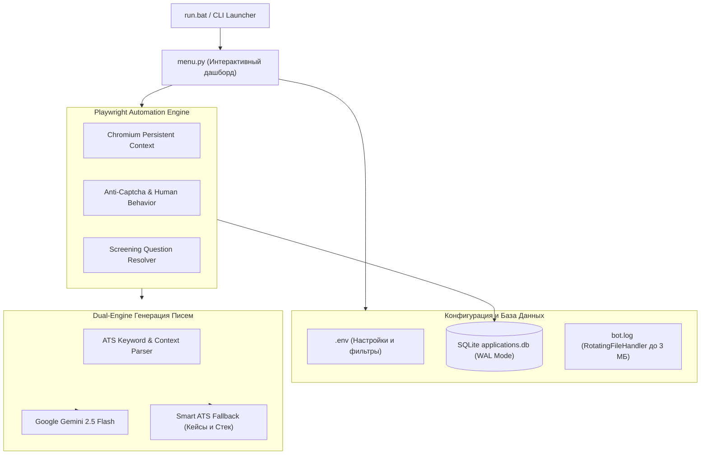

# 🚀 HH.ru Auto-Reply Bot | Smart ATS & Dual-Engine AI

[](https://python.org)
[](https://playwright.dev)
[](https://sqlite.org)
[](https://ai.google.dev/)
[](LICENSE)

> **Автономный интеллектуальный комбайн для автоматизации откликов на hh.ru** с интерактивным CLI-дашбордом, антидетект-сессией Playwright, автоматическим заполнением анкет и динамической генерацией сопроводительных писем под требования конкретной вакансии (ATS Matching).

---

## 📌 Проблема и Инженерное Решение

| Проблема классического поиска | Решение в данном проекте |
| :--- | :--- |
| **Скрининг HR-ботов:** 80% откликов отсекаются за отсутствие ключевых слов в первые секунды. | **Smart ATS Engine:** бот анализирует стек вакансии (B2B SaaS, Design Systems, Mobile, Prepress, Frontend) и формирует письмо с точными кейсами под задачу. |
| **Рутина и потеря времени:** монотонный поиск и заполнение форм отнимают по 3-4 часа в день. | **Автономная обработка:** безопасный сбор вакансий по вашим фильтрам, автоматические отклики и соблюдение лимитов. |
| **Сложные анкеты работодателей:** многие компании блокируют простой отклик вопросами (опыт, зарплата, гражданство, ссылки). | **Screening Auto-Solver:** автоматическое распознавание текстовых полей, выпадающих списков, радиокнопок и числовых полей. |
| **Раздувание кеша браузера:** профили автоматизации за пару дней вырастают до 1–2 ГБ. | **Zero-Bloat Capping:** ограничение кеша Chromium до 10 МБ + встроенная утилита быстрой очистки временных файлов. |

---

## 🏗 Архитектура системы



---

## ✨ Ключевые возможности

1. **Интерактивный терминальный дашборд (`menu.py`)**:
   * Быстрый запуск и мониторинг дневного лимита.
   * Статистика и аналитика откликов: общее число, уникальные компании, динамика за неделю и последние отклики.
   * Управление конфигурацией (`.env`) прямо из консоли без блокнота.
   * Песочница тестирования генератора писем под произвольную вакансию.
   * 1-click проверка сессии в браузере и моментальная очистка дискового кеша.
2. **Dual-Engine Генерация писем**:
   * **Google Gemini 2.5 Flash:** глубокая контекстная персонализация через официальный Google GenAI SDK.
   * **Smart ATS Local Fallback:** мгновенная генерация без задержек и без зависимости от VPN/прокси в случае гео-блокировок. Подставляет релевантный опыт (B2B SaaS-платформы, Highload SPA, Design Systems, Adobe CC).
3. **Безопасность и антидетект**:
   * Изолированный профиль `browser_profile/` — вход на hh.ru выполняется один раз, cookies и токены сохраняются локально.
   * Человекоподобные случайные задержки (4–10 сек) и отключение флагов автоматизации Chromium (`AutomationControlled`).
   * Мягкое ненавязчивое звуковое оповещение Windows при появлении капчи.
4. **Умный автоответчик на вопросы (Screening Forms)**:
   * Автоматически отвечает на вопросы об опыте, гражданстве, городе, зарплатных ожиданиях, портфолио и ссылках на профили.
5. **Надежное хранилище SQLite (WAL Mode)**:
   * Защита от дубликатов откликов даже при перезапуске или повторной выдаче поисковой выдачи hh.ru.

---

## 🖥 Консольный интерфейс (CLI Dashboard)

```text
┌────────────────────────────────────────────────────────────────────────┐
│  HH.RU AUTO-REPLY BOT — Design Technologist & UI/UX Edition            │
│  GitHub: @228burger228  •  v2.0 Business-Premium CLI                    │
├────────────────────────────────────────────────────────────────────────┤
│  Статус: ● Активен | Сегодня: 0/60 | Всего в базе: 216                 │
└────────────────────────────────────────────────────────────────────────┘

ГЛАВНОЕ МЕНЮ ДЕЙСТВИЙ:
  [1] 🚀 Запустить автоотклик (поиск и отправка писем)
  [2] 📊 Аналитика и статистика (графики и история в БД)
  [3] ⚙️  Настройки и фильтры (изменение .env из консоли)
  [4] 📝 Тест генератора писем (Smart ATS песочница)
  [5] 🔑 Проверка сессии hh.ru (открыть окно браузера)
  [6] 🧹 Очистить кеш браузера (освободить диск)
  [0] 🚪 Выход
```

---

## 🚀 Быстрый старт

### 1. Клонирование репозитория
```bash
git clone https://github.com/228burger228/hh-auto-reply.git
cd hh-auto-reply
```

### 2. Установка зависимостей
```bash
pip install -r requirements.txt
playwright install chromium
```

### 3. Настройка параметров
Скопируйте пример конфигурации:
```bash
cp .env.example .env
```
Или запустите меню и настройте параметры через пункт `[3]`:
* `HH_SEARCH_URL`: ссылка на страницу с вашими фильтрами на hh.ru.
* `MAX_APPLIES_PER_DAY`: дневной лимит (рекомендуется 50–70).
* `ANSWER_PHONE` / `ANSWER_EMAIL`: ваши контакты для автозаполнения форм.

### 4. Запуск
* **В Windows**: просто дважды кликните по **`run.bat`**.
* **Прямой запуск без меню**:
```bash
run.bat --direct
# или
python bot.py
```

---

## 📁 Структура проекта

```text
hh_auto_reply/
├── run.bat                 # Запуск меню / бота под Windows в UTF-8
├── menu.py                 # Интерактивный CLI-дашборд и менеджер
├── bot.py                  # Главный цикл автоматизации Playwright
├── ai_generator.py         # Gemini 2.5 Flash + Local Smart ATS Engine
├── database.py             # SQLite база данных (WAL режим, аналитика)
├── config.py               # Загрузка и валидация настроек
├── clean_cache.bat         # Скрипт быстрой очистки дискового кеша
├── requirements.txt        # Зависимости проекта
├── .env.example            # Шаблон переменных окружения
├── .gitignore              # Исключение сессий, логов и базы данных
├── LICENSE                 # Открытая лицензия MIT
└── README.md               # Документация проекта
```

---

## 🔒 Конфиденциальность и безопасность

* Файл `.env`, база данных `applications.db` и папка профиля `browser_profile/` внесены в `.gitignore` и **никогда не попадают в Git**.
* Бот не использует сторонние облачные сервисы для передачи сессий: вся автоматизация происходит локально на вашем компьютере.

---

## 👤 Автор

**Дмитрий** — Design Technologist, Product UI/UX & Frontend Developer  
* GitHub: [@228burger228](https://github.com/228burger228)  
* Портфолио: [228burger228.github.io/burgerportfolio2.0](https://228burger228.github.io/burgerportfolio2.0/#design)  


---

## 📄 Лицензия

Проект распространяется под лицензией [MIT](LICENSE).
